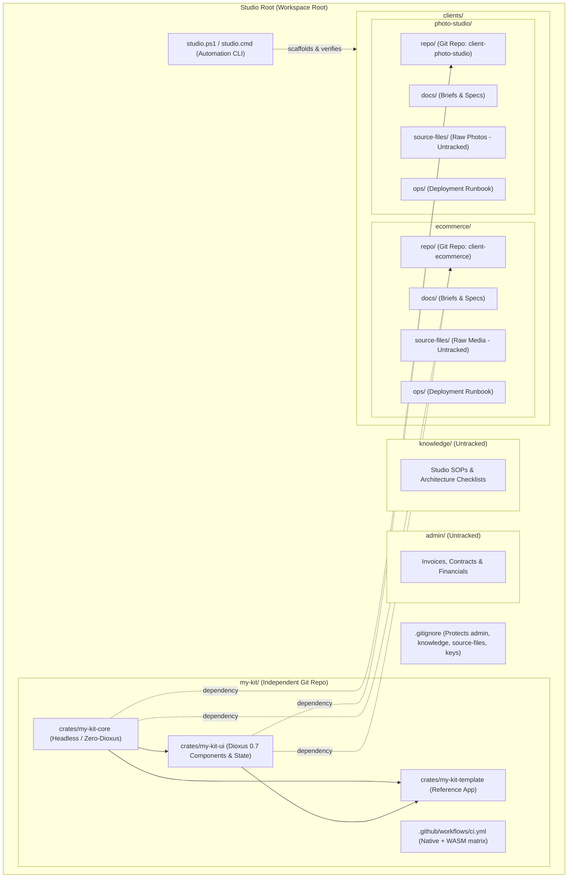

# Startup Studio Developer Guide

Welcome to the **Startup Studio** engineering workspace. This folder structure orchestrates the shared core engine ([`my-kit/`](./my-kit)), production client ventures ([`clients/`](./clients)), internal knowledge bases ([`knowledge/`](./knowledge)), and business operations ([`admin/`](./admin)).

---

## 1. High-Level Architecture & Repository Boundaries

The studio employs an **isolated multi-repo workspace structure**. The studio root directory is deliberately **NOT** a unified Git repository; instead, repositories are isolated to maintain strict security boundaries and permit separate client handovers.



---

## 2. Directory Structure & Folder Responsibilities

| Directory | Git Status | Purpose & Contents |
| :--- | :--- | :--- |
| [`admin/`](./admin) | **Untracked** (Safety filter) | Confidential studio business files: invoices, pricing calculators, contracts, and legal templates. |
| [`knowledge/`](./knowledge) | **Untracked** (Safety filter) | Internal playbooks, design system specs, technical guidelines, and onboarding guides. |
| [`my-kit/`](./my-kit) | **Git Repo** (`my-kit.git`) | Shared core engine across all ventures. Multi-crate Rust workspace (`core`, `ui`, `template`). |
| [`clients/`](./clients) | Container | Parent folder for all client and internal ventures. |
| `clients/<name>/repo/` | **Git Repo** (`client-<name>.git`) | Production application code built on Dioxus and `my-kit`. |
| `clients/<name>/docs/` | Local / Client Shared | Product brief, milestone delivery plan, and requirements specifications. |
| `clients/<name>/source-files/` | **Untracked** (Safety filter) | Raw, uncompressed high-resolution images, video assets, Figma exports, or design deliverables. |
| `clients/<name>/ops/` | Local / Client Shared | Deployment guides, domain records, hosting configurations (never commit private keys). |

> [!CAUTION] Security & Leak Prevention
> The file [`.gitignore`](./.gitignore) at the studio root prevents accidental commits of `admin/`, `knowledge/`, `clients/**/source-files/`, `.env` files, and `.key`/`.pem` certificates. Never remove or bypass these safety rules.

---

## 3. Studio Automation Tooling (`studio.ps1` & `studio.cmd`)

The studio includes a unified automation tool ([`studio.ps1`](./studio.ps1) and [`studio.cmd`](./studio.cmd)) for developer convenience.

You can run commands using PowerShell (`.\studio.ps1 <command>`) or Command Prompt / any terminal (`studio <command>`).

### A. Scaffolding a New Client Venture
To create a new venture structure with all standard folders, initialized Git repository, and configured dependencies:

```powershell
# Web-only venture (lightweight Dioxus web app)
.\studio.ps1 new brand-store --type web

# Hybrid desktop/web venture (includes desktop shell)
.\studio.ps1 new agency-portal --type hybrid

# Scaffold targeting published Git tags directly
.\studio.ps1 new mobile-client --type web --source git --Tag v0.1.0
```

**What this creates automatically:**
1. `clients/<name>/docs/BRIEF.md` (pre-populated scope template)
2. `clients/<name>/ops/DEPLOYMENT.md` (pre-populated deployment guide)
3. `clients/<name>/source-files/.gitkeep` (raw asset staging)
4. `clients/<name>/repo/` (cloned from `my-kit-template` starter)
5. `clients/<name>/repo/.gitignore` (ignores `/target` and `.cargo/config.toml`, keeps `Cargo.lock` tracked)
6. `clients/<name>/repo/.cargo/config.toml` (local path patching for instant builds)
7. Initialized standalone Git repository in `repo/`

### B. Switching Dependency Modes (`path` vs. `git`)
Client applications can switch between local workspace paths and remote GitHub releases with one command:

```powershell
# Switch to remote GitHub releases (for client handoff or remote CI)
.\studio.ps1 switch-source ecommerce -Source git -Tag v0.1.0

# Switch back to local monorepo paths (for fast offline local iteration)
.\studio.ps1 switch-source ecommerce -Source path
```

### C. Upgrading a Client to a New `my-kit` Version
When a new version of `my-kit` is released:

```powershell
# Bump client dependency tag to v0.2.0 and run cargo update
.\studio.ps1 upgrade ecommerce -Tag v0.2.0

# Bump tag AND sync latest semantic design tokens from my-kit-ui/assets/main.css
.\studio.ps1 upgrade ecommerce -Tag v0.2.0 -SyncStyles
```

### D. Comprehensive Ecosystem Verification
Run a single command to verify the health of the entire studio:

```powershell
.\studio.ps1 check
```

**What `check` validates:**
- `my-kit`: workspace build (`cargo check`)
- `my-kit`: test suite (`cargo test`, 61+ tests)
- `my-kit`: strict Clippy lints (`cargo clippy -- -D warnings`)
- `my-kit-core`: WebAssembly compatibility (`cargo check -p my-kit-core --target wasm32-unknown-unknown`)
- Every client repository located in `clients/*/repo`: verifies clean compilation

---

## 4. Working with the Core Engine (`my-kit/`)

[`my-kit`](./my-kit) is a Rust 2024 Cargo Workspace partitioned into three distinct crates:

### 1. [`crates/my-kit-core`](./my-kit/crates/my-kit-core) (Headless Platform & Domain Engine)
- **Zero UI Dependencies**: Pure Rust algorithms and models. Has no Dioxus dependencies.
- **Platform Agnostic & WASM-Safe**: Compiles for native OS and `wasm32-unknown-unknown`.
- **Key Modules**:
  - `base`: Math, collection utilities, text manipulation, ISO timestamps, typed errors (`AppError`).
  - `platform::storage`: Panic-free `KeyValueStore` trait. Safe for WebAssembly, Web Workers, and SSR (`LocalStorage` gracefully checks `window` without `.unwrap()`). Desktop file persistence uses `FileStorage`.
  - `platform::env`: Rust 2024 compliant `.env` loader with documented unsafe blocks.
  - `forms`: Reactive form state (`Field<T>`), touched/dirty status, and composable validators (`required`, `email`, `min_len`, `pattern`).
  - `media`: Dimension calculations, aspect ratios, EXIF orientations, and boundary fitting (`fit_contain`, `fit_cover`).
  - `auth`: `TokenSession`, JWT `Claims`, role validation, and authorization headers.

### 2. [`crates/my-kit-ui`](./my-kit/crates/my-kit-ui) (Dioxus 0.7 Components & Design Tokens)
- Built on **Dioxus 0.7.1**.
- **Reactive Hooks**: `use_theme`, `use_notices`, `use_form`, `use_auth`, `use_persistent`, `use_debounce`, `use_now`.
- **Accessible Components**: `Button`, `Badge`, `Banner`, `Modal`, `ProgressBar`, `EmptyState`, `FormField`, `TextInput`, `TextArea`, `Select`, `AuthGuard`.
- **Design Tokens**: Defined in [`my-kit-ui/assets/main.css`](./my-kit/crates/my-kit-ui/assets/main.css) using semantic CSS custom properties (`--bg-primary`, `--accent-primary`, etc.).

### 3. [`crates/my-kit-template`](./my-kit/crates/my-kit-template) (Showcase & Scaffold Source)
- Interactive reference application demonstrating theme switching, interactive form validation, animated notices, and auth guards.
- Default feature set to `default = ["web"]` to keep daily compilation fast and light on disk space.

### Testing and Linting `my-kit`
```powershell
cd my-kit

# Run tests
cargo test --workspace

# Strict lint check
cargo clippy --workspace -- -D warnings

# WebAssembly target verification
cargo check -p my-kit-core --target wasm32-unknown-unknown

# Run the template showcase app in browser
dx serve --package my-kit-template --platform web
```

---

## 5. Client Development Workflow

Each client venture lives in [`clients/<client_name>/repo/`](./clients).

### Local Build vs. Remote CI Mechanics
Client `Cargo.toml` points to the local or remote release:
```toml
[dependencies]
dioxus = { version = "0.7.1" }
my-kit-core = { path = "../../../my-kit/crates/my-kit-core", version = "0.1.0" }
my-kit-ui = { path = "../../../my-kit/crates/my-kit-ui", version = "0.1.0" }
```

When configured for Git releases (`git = "https://github.com/subrataai-wq/my-kit.git", tag = "v0.1.0"`), `studio.ps1` injects a local `.cargo/config.toml`:
```toml
[patch."https://github.com/subrataai-wq/my-kit.git"]
my-kit-core = { path = "../../../my-kit/crates/my-kit-core" }
my-kit-ui = { path = "../../../my-kit/crates/my-kit-ui" }
```
Because `.cargo/config.toml` is in `.gitignore`, your local machine compiles against local disk changes instantly, while remote CI compiles against the tagged GitHub release!

### Running Client Applications
```powershell
cd clients/ecommerce/repo

# Run in Web browser
dx serve --platform web

# Run as Desktop app (for hybrid ventures like photo-studio)
dx serve --platform desktop
```

> [!IMPORTANT] Version Control Rules for Client Applications
> In client application repositories (`clients/<name>/repo`), **always commit `Cargo.lock`**. Committing `Cargo.lock` guarantees that production deployments and remote CI use the exact same dependency versions tested locally.

---

## 6. Daily Developer Best Practices

1. **Keep Secrets Out of Code**: Never commit API keys, payment secrets, or database URLs. Use `.env` locally (loaded via `my_kit_core::platform::env::load_dotenv()`) and store `.env.example` templates in `ops/`.
2. **Raw Media in `source-files/`**: Always place original high-resolution client media files (uncompressed 4K images, footage, raw design archives) into `source-files/`. These folders are git-ignored to prevent bloated repository history.
3. **Run Health Checks Before Handoff**: Run `.\studio.ps1 check` before pushing updates or tagging releases to confirm zero warnings across all crates and client repos.
4. **Cloud Backup**: Non-git directories (`admin/`, `knowledge/`, `source-files/`) contain valuable company and client assets. Maintain periodic encrypted backups (e.g., Google Drive, Cloudflare R2, or external backup drive).
