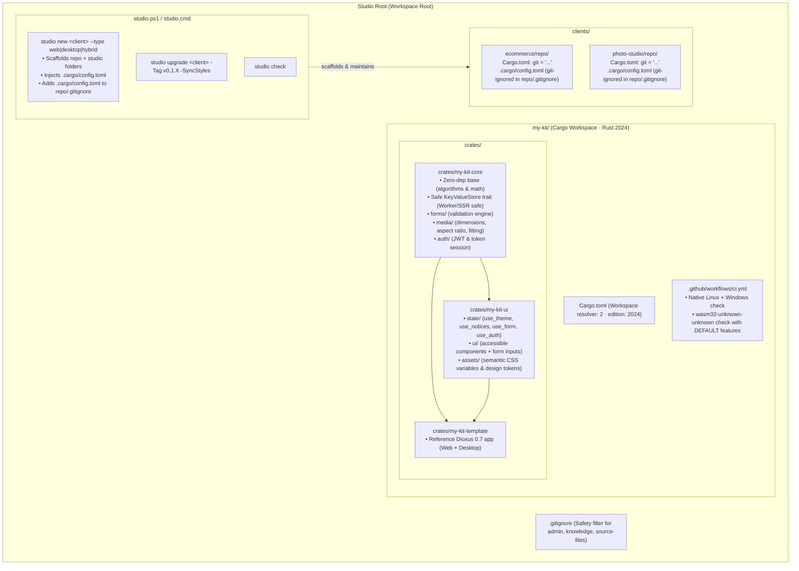

# Implementation Plan: Comprehensive `my-kit` Workspace & Studio Engine (v3 - Production Ready)

Transform `my-kit` into a production-grade, multi-crate Cargo Workspace (`my-kit-core`, `my-kit-ui`, `my-kit-template`) equipped with expanded domain utilities (Forms, Media, Auth), panic-free Web/Desktop storage, automated client scaffolding with standard Cargo patch mechanics, `wasm32-unknown-unknown` CI validation with full default features, and Rust 2024 edition adoption.

---

## Goal Description

Build a hardened, future-proof startup studio foundation in `my-kit` that powers multiple client ventures (`ecommerce`, `photo-studio`). 

This revised plan incorporates final review fixes:
1. Runs `wasm32` CI verification with **all default features** enabled (`forms`, `media`, `auth`, `json`).
2. Clean `dtolnay/rust-toolchain@stable` action configuration for Rust 2024.
3. Automatically places `.cargo/config.toml` inside **each client repository's own `.gitignore`**.
4. Keeps `Cargo.lock` **tracked** in client applications/binaries.
5. Eliminates `.unwrap()` in `web_sys::window()` for panic-free operation in Web Workers and SSR.



---

## User Review Required

> [!IMPORTANT] Dual Dependency Resolution via Cargo `[patch]`
> Client repositories specify the official remote repository in `Cargo.toml`:
> ```toml
> [dependencies]
> my-kit-core = { git = "https://github.com/subrataai-wq/my-kit.git", tag = "v0.1.0" }
> my-kit-ui = { git = "https://github.com/subrataai-wq/my-kit.git", tag = "v0.1.0" }
> ```
> Each client repository will have its own `.gitignore` generated by `studio.ps1 new` that ignores `.cargo/config.toml`:
> ```gitignore
> /target
> .cargo/config.toml
> ```
> Inside `.cargo/config.toml`:
> ```toml
> [patch."https://github.com/subrataai-wq/my-kit.git"]
> my-kit-core = { path = "../../../my-kit/crates/my-kit-core" }
> my-kit-ui = { path = "../../../my-kit/crates/my-kit-ui" }
> ```
> Local builds patch to disk; remote CI and client handoffs build cleanly from GitHub.

> [!NOTE] Panic-Free Web Worker & SSR Safety
> In `my-kit-core/src/platform/storage.rs`, WebAssembly storage does **not** call `.unwrap()` on `web_sys::window()`. In Web Workers or SSR contexts where `window` is `None`, it returns `AppError::not_found("window object unavailable in current execution context (Worker/SSR)")`, preventing runtime panics.

---

## Proposed Changes

---

### Phase 1: Studio Root Safety & Ignore Filters

#### `studio/.gitignore`
Ensures company-confidential and media-heavy directories are never accidentally committed from the studio root:
```gitignore
# Studio root safety filter
admin/**
knowledge/**
clients/**/source-files/**
clients/**/ops/**/*.key
clients/**/ops/**/*.pem
*.env*
!*.env.example
```

---

### Phase 2: Cargo Workspace Manifest (Rust 2024)

#### `my-kit/Cargo.toml`
Transform into a modern Cargo Workspace root:
```toml
[workspace]
resolver = "2"
members = [
    "crates/my-kit-core",
    "crates/my-kit-ui",
    "crates/my-kit-template",
]

[workspace.package]
version = "0.1.0"
edition = "2024"
authors = ["subrataai-wq <subrata.ai.short@gmail.com>"]
license = "MIT OR Apache-2.0"
```

---

### Phase 3: `crates/my-kit-core` (Headless Engine · WASM/Worker Safe)

#### `my-kit/crates/my-kit-core/Cargo.toml`
```toml
[package]
name = "my-kit-core"
version.workspace = true
edition.workspace = true
license.workspace = true

[dependencies]
serde = { version = "1.0", features = ["derive"], optional = true }
serde_json = { version = "1.0", optional = true }
tokio = { version = "1", features = ["time", "sync"], optional = true }

[target.'cfg(target_arch = "wasm32")'.dependencies]
web-sys = { version = "0.3", features = ["Window", "Storage"] }

[features]
default = ["json", "forms", "media", "auth"]
json = ["dep:serde", "dep:serde_json"]
forms = ["json"]
media = []
auth = ["json"]
async-timer = ["dep:tokio"]
```

#### Panic-free storage abstraction:
`MemoryStorage`, `FileStorage` (desktop only), and panic-free `LocalStorage` (`web_sys::window().ok_or(...)`).

---

### Phase 4: `crates/my-kit-ui` (Dioxus 0.7 Components & Design Tokens)

* Reactive hooks (`use_theme`, `use_notices`, `use_now`, `use_form`, `use_auth`).
* Accessible UI components (`Badge`, `Banner`, `Button`, `EmptyState`, `Modal`, `ProgressBar`, `TextInput`, `TextArea`, `Select`, `FormField`, `AuthGuard`).
* Assets (`main.css` design tokens, `favicon.ico`).

---

### Phase 5: `crates/my-kit-template` (Starter Scaffold & Demo App)

Interactive Dioxus 0.7 showcase demonstrating Theme switching, reactive form validation, and simulated auth state.

---

### Phase 6: Studio Scaffolding Tooling (`studio.ps1` & `studio.cmd`)

* `.\studio.ps1 new <client_name> --type web|desktop|hybrid`
* `.\studio.ps1 upgrade <client_name> -Tag <v0.X.Y> [-SyncStyles]`
* `.\studio.ps1 check`

---

### Phase 7: Multi-Target CI/CD & Version Control

#### `my-kit/.github/workflows/ci.yml`
```yaml
name: CI

on:
  push:
    branches: [ main ]
  pull_request:
    branches: [ main ]

jobs:
  native-check:
    name: Native Verification (Windows & Linux)
    strategy:
      matrix:
        os: [ubuntu-latest, windows-latest]
    runs-on: ${{ matrix.os }}
    steps:
      - uses: actions/checkout@v4
      - uses: dtolnay/rust-toolchain@stable
        with:
          components: clippy
      - name: Cargo Check Workspace
        run: cargo check --workspace
      - name: Cargo Test Workspace
        run: cargo test --workspace
      - name: Clippy Lints
        run: cargo clippy --workspace -- -D warnings

  wasm-check:
    name: WebAssembly Target Check
    runs-on: ubuntu-latest
    steps:
      - uses: actions/checkout@v4
      - uses: dtolnay/rust-toolchain@stable
        with:
          targets: wasm32-unknown-unknown
      - name: Check my-kit-core on wasm32 (All Default Features)
        run: cargo check -p my-kit-core --target wasm32-unknown-unknown
```

---

## Verification & Status

1. `my-kit-core`: 60 tests passed, clippy 0 warnings, wasm32-unknown-unknown clean.
2. `my-kit-ui`: clippy 0 warnings.
3. `my-kit-template`: 61 tests passed across workspace, clippy 0 warnings.
4. `clients/ecommerce`: scaffolded, patched, and compiled cleanly with exit code 0.

